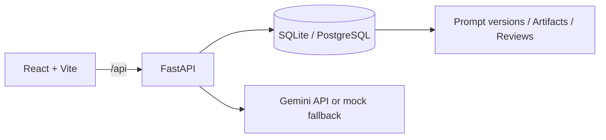

# Prompt & Artifact Registry

**Goa Hackathon 2026 · AI Governance / Developer Tools · MVP**

> A platform for versioning AI prompts, generating traceable artifacts, and reviewing outputs through auditable approval workflows.

## Why it matters

AI-generated outputs can be difficult to reproduce or review. This MVP links each generated artifact to its exact prompt version and generation metadata, giving teams a record of what produced an output and who approved it.

## Features

- **Prompt management:** Create prompts and immutable numbered versions.
- **Artifact generation:** Generate content with Gemini when configured; otherwise clearly marked mock output.
- **Lineage:** Trace artifact → prompt version → parent prompt, with generation metadata.
- **Approvals:** Pending Review → Approved / Rejected, with reviewer comments.
- **Audit logs:** Backend records key create, version, generation, status and review actions (audit-log viewer not yet implemented).
- **Authentication:** JWT login with Author, Reviewer, Approver, and Admin roles.

## Stack

| Layer | Technology |
| --- | --- |
| Frontend | React, Vite, Tailwind CSS, Axios |
| Backend | Python, FastAPI, SQLAlchemy |
| Data | SQLite locally; PostgreSQL / Supabase in deployment |
| AI | Gemini REST API with explicitly marked mock fallback |
| Hosting | Vercel configuration included (verify against your deployment) |

## Architecture



## Run locally (Windows PowerShell)

Prerequisites: Python 3.10+ and Node.js with npm.

**Terminal 1 — API (from repository root):**

```powershell
py -m venv .venv
.\.venv\Scripts\python.exe -m pip install -r backend/requirements.txt
Copy-Item .env.example .env
# Edit .env: set SECRET_KEY; optionally GEMINI_API_KEY
.\.venv\Scripts\python.exe -m uvicorn main:app --app-dir backend --reload --port 8000
```

**Terminal 2 — web:**

```powershell
cd frontend
npm ci
npm run dev
```

Open **http://localhost:5173**. API health: **http://localhost:8000/health**. API docs: **http://localhost:8000/docs**.

### Optional local demo admin

From the repository root, set a strong password and seed:

```powershell
$env:DEMO_ADMIN_PASSWORD="ReplaceWithYourOwnLongPassword123!"
.\.venv\Scripts\python.exe seed.py
```

Sign in as `demo_admin` using the password you set. Public signup creates **Author** accounts only; other roles must be assigned by a trusted administrator through the database for this MVP.

## Demo flow for judges

1. Sign in as demo admin; create a prompt and a version.
2. Generate an artifact (show whether output is **Gemini** or **mock**).
3. Open the artifact lineage and inspect the prompt version and metadata.
4. Approve or reject the pending artifact with a comment.
5. Show the artifact's updated status and approval history.

## API highlights

| Method | Endpoint | Purpose |
| --- | --- | --- |
| POST | `/auth/signup` | Register Author |
| POST | `/auth/token` | Obtain JWT |
| GET | `/auth/me` | Current user |
| POST / GET | `/prompts/` | Create / list prompts |
| POST / GET | `/prompts/{id}/versions/` | Create / list versions |
| POST | `/artifacts/generate?prompt_version_id={id}` | Generate artifact |
| GET | `/lineage/{artifact_id}` | Artifact lineage |
| POST | `/artifacts/{artifact_id}/approve` | Review artifact |
| GET | `/approvals/history/{artifact_id}` | Review history |

Frontend uses the `/api` prefix, which Vite proxies to FastAPI during development.

## Environment variables

Copy `.env.example` to `.env` and **never commit `.env`**.

| Variable | Required | Notes |
| --- | --- | --- |
| `SECRET_KEY` | Production | Strong random JWT signing secret |
| `GEMINI_API_KEY` | No | Missing key activates mock generation |
| `DATABASE_URL` / `POSTGRES_URL` | Production | PostgreSQL connection string |
| `DEMO_ADMIN_PASSWORD` | Demo seed only | 12+ characters |

> Do not use local SQLite for durable storage on serverless deployments. Use PostgreSQL. The existing Vercel config is included but has not been deployment-tested here.

## MVP limitations and next steps

- Role assignment is manual for trusted admins; no role-management UI yet.
- The approval process is a single decision, not a multi-stage review chain.
- Audit entries are stored but no audit-log page or export is implemented.
- Model errors and quota issues may produce fallback or error artifacts; check metadata during the demo.
- No automated integration-test suite, rate limiting, or migration framework yet.
- For production: add admin role-management endpoints, CSRF/token hardening, migration tooling, comprehensive tests, and stronger audit integrity.

## Project structure

```text
api/                 Vercel FastAPI entry point
backend/             API, models, schemas, Gemini service
frontend/src/pages/  Dashboard, Prompt Manager, Artifact Registry,
                     Lineage View, Approval Inbox, Login
seed.py              Optional demo data
vercel.json          Deployment configuration
.env.example         Environment template
```

## License

No license is granted by default. Add a LICENSE file after choosing appropriate terms and confirming rights to all included code.
